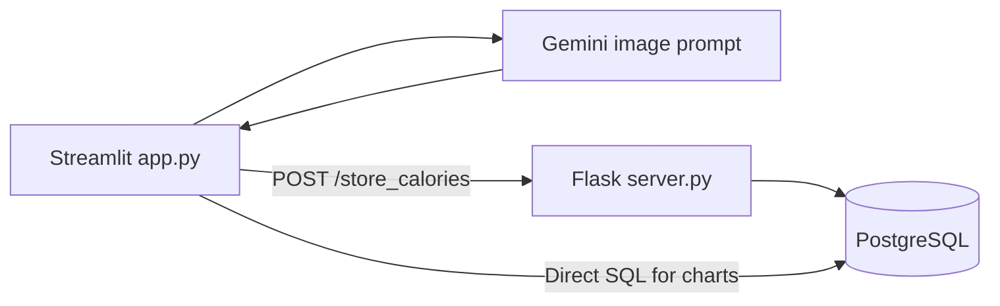

# calorify

**An image-assisted calorie logging prototype built with Streamlit, Flask, PostgreSQL, and Gemini.**

calorify sends a meal image and prompt to a generative model, extracts a calorie estimate from the response, and posts it to a Flask persistence endpoint. Streamlit also queries PostgreSQL directly to display daily entries and aggregate charts. The application demonstrates the workflow; image-derived values are estimates, and the current implementation does not provide reliable per-user isolation.

## Architecture



| Component | Responsibility |
| --- | --- |
| `app.py` | Image upload, model request, calorie parsing, daily totals, and Plotly charts. |
| `server.py` | Primary Flask registration/login pages and calorie-write endpoint. |
| `server2.py` | Alternative Flask implementation with an unfinished image-upload path. |
| `templates/` | Login, registration, and an iframe-based Streamlit landing page. |
| `adding_sample_data.ipynb` | Synthetic record generation and direct database insertion. |
| `sample_data.csv` | Example calorie records using a neutral demo address. |

## Local setup

Use Python 3.11+ as a starting environment and provide a local PostgreSQL instance. Dependencies are unpinned; the original model/runtime compatibility matrix is not recorded.

```bash
git clone https://github.com/quixoticalcoder/calorify.git
cd calorify
python3 -m venv .venv
source .venv/bin/activate
pip install -r requirements.txt
cp .env.example .env
```

On Windows, activate with `.venv\Scripts\activate`. Configure `.env`:

| Variable | Purpose |
| --- | --- |
| `API_KEY` | Google generative-model credential. |
| `SECRET_KEY` | Flask session signing secret used by `server.py`. |
| `FLASK_SERVER_URL` | Flask origin, normally `http://127.0.0.1:5000`. |
| `DB_HOST`, `DB_PORT` | PostgreSQL connection host and port. |
| `DB_NAME`, `DB_USER`, `DB_PASSWORD` | PostgreSQL database and credentials. |
| `DATABASE_URL` | Optional connection URL for `server2.py` only. |

No schema migration or database bootstrap script is included. Create compatible tables before starting the application:

- `users`: `user_name`, unique `user_email`, and `password` columns used by registration/login.
- `calories`: `cal_id`, `user_email`, numeric `calories`, and `time_stamp` with a suitable default for inserts that omit it.

The Streamlit tracker currently writes to `demo@calorify.example`; create a matching demo user if your schema enforces a foreign key. The notebook uses `timestamp` in CSV data and maps it to the SQL column `time_stamp`.

Start the primary Flask service:

```bash
python server.py
```

In a second terminal with the environment activated:

```bash
python -m streamlit run app.py
```

Use Streamlit directly at the printed URL, normally `http://localhost:8501`. The Flask landing page embeds a hardcoded private-network Streamlit address; update that iframe for your environment before using it. Do not start both Flask implementations on their default port simultaneously.

## Workflow and API

1. Open **Tracker** and upload a JPG, JPEG, or PNG image.
2. Submit the default meal-analysis prompt or a manual query.
3. The model response is split on the literal marker `Total calories:`.
4. The extracted value is sent to Flask and stored in PostgreSQL.
5. **Home** displays today's entries and their sum. **Dashboard** displays average calories per entry grouped by date or weekday.

The home screen compares entries against a hardcoded 2,000-calorie display target. It is not a configurable or personalized goal. Dashboard averages are not daily consumption totals.

| Primary Flask route | Behavior |
| --- | --- |
| `GET/POST /register` | Registration form and user insertion. |
| `GET/POST /login` | Login form and session creation. |
| `GET /` | Session-gated page embedding Streamlit. |
| `POST /store_calories` | Inserts the supplied email and calorie value without session enforcement. |

Example against a configured disposable database:

```bash
curl -X POST http://127.0.0.1:5000/store_calories \
  -H 'Content-Type: application/json' \
  -d '{"user_email":"demo@calorify.example","calories":420}'
```

The AI code hardcodes `gemini-pro-vision` through `google.generativeai`. This is an inherited identifier, not a verified currently supported model. Provider/model compatibility must be addressed before expecting live image inference. There is no model-selection environment variable.

## Implementation limits

- **Authentication:** Streamlit is accessible independently of Flask login. Chart queries aggregate all records, while writes use a fixed demo email. User sessions are not propagated between the applications.
- **Database security:** primary registration/login queries interpolate input into SQL. Passwords use unsalted SHA-256, and registration logs submitted credentials. These paths require changes before handling real accounts.
- **Form mismatch:** the registration template submits `username`, but `server.py` reads `name`. The alternative server expects `username` but does not configure its Flask secret key for sessions/flash messages.
- **Image parsing:** model output is free text with brittle string splitting, no numeric validation, and no structured response contract. Missing uploads or unexpected responses can fail the request.
- **Alternative upload path:** `server2.py` passes an uploaded file object to code expecting a base64 data URL, then passes bytes to a helper expecting a list of image parts. This path is incomplete.
- **Follow-up chat:** controls are nested inside the initial Streamlit submit branch and are not backed by persistent session state or conversation history.
- **Sample notebook:** insertion cells write directly to the configured database. The notebook includes an out-of-order `conn.close()` and is not a dependable seed command.
- **Deployment:** both Flask apps enable debug mode and broad CORS. There are no maintained migrations, automated tests, or production deployment configuration.

## Verification

```bash
python -m compileall -q app.py server.py server2.py
python -m pip check
```

Isolated Flask checks can verify rendered forms and the parameterized calorie-insert path with a mocked database. They do not validate PostgreSQL schema compatibility, live Gemini inference, account isolation, or estimate accuracy. Use disposable records when testing the integration.

## License

No project-wide license file is included. Review permissions for code and image assets before reuse or redistribution.
